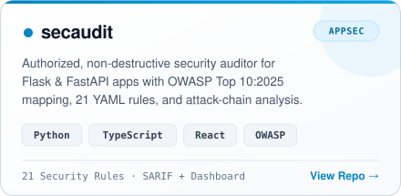
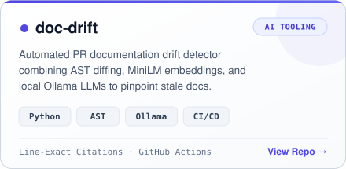
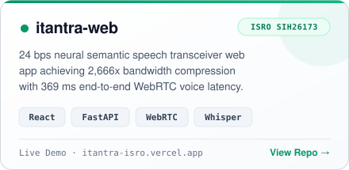
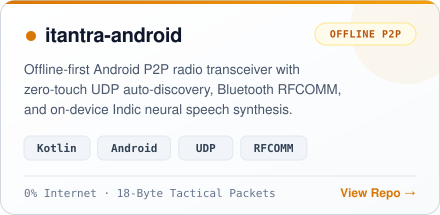
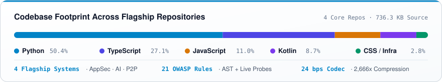

  

  

  
  
  

---

### What I Build

- **Application Security & Static Analysis** — Non-destructive security auditing for Flask/FastAPI backends mapped to **OWASP Top 10:2025** & CWE ([`secaudit`](https://github.com/DakshG26/secaudit)).
- **AI Developer Tooling** — Hybrid AST diffing, `all-MiniLM-L6-v2` embeddings, and local open-weight LLMs to catch documentation drift before merge ([`doc-drift`](https://github.com/DakshG26/doc-drift)).
- **Low-Bandwidth & Offline-First Systems** — `24 bps` neural semantic speech compression and zero-internet P2P mesh communication across Web and Android ([`iTantra`](https://github.com/DakshG26/itantra-web)).

---

### Featured Systems

  
  &nbsp;
  

  
  &nbsp;
  

---

### Engineering Snapshot

  

---

### Core Stack

  

  

